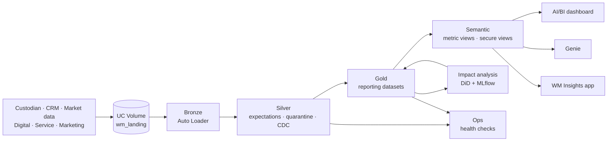

# Wealth Management Performance & Reporting Lakehouse (Databricks)

An end-to-end Databricks project for a Wealth Management reporting and analytics team:
**standardized reporting datasets → governed semantic layer → dashboards → incremental-impact
measurement → self-serve tools**, deployed as a single Asset Bundle with dev/test/prod and CI/CD.

It runs on realistic synthetic data for a Canadian wealth division. That covers 17 upstream feeds, registered
plans (RRSP, TFSA, RESP, RRIF, FHSA), advisor → branch → region hierarchies, custodian re-sends and restatements, and
two randomized campaigns with known effects. Every number can therefore be checked against ground truth.

> **How the project maps to the role:** see [`docs/requirements_traceability.md`](docs/requirements_traceability.md).

## What's inside

| Layer | Databricks features | Highlights |
|---|---|---|
| **Ingestion** | UC Volumes, Auto Loader, Lakeflow Declarative Pipelines | Metadata-driven bronze for 17 feeds. Lineage columns, rescued data and schema evolution |
| **Silver** | Expectations, AUTO CDC (SCD1 / SCD2), quarantine tables | DQ rules declared once and shared by the pipeline, quarantine and tests. Idempotent dedupe of custodian re-sends |
| **Gold** | Materialized views, liquid clustering | 18 reporting datasets: AUM bridge, TWR / Modified Dietz, AUM with as-was branch attribution, household 360, advisor balanced scorecard, service quality, digital engagement, campaign panels |
| **Semantic** | **Unity Catalog metric views**, metric catalog table | 37 certified measures. Semi-additive AUM handled correctly. Ratio measures stay valid for any time window |
| **Dashboards** | AI/BI (Lakeview) dashboard, built from code | 5 pages: Executive overview · Advisor scorecard · Client experience & service · Initiative impact · Platform health |
| **Impact analytics** | Jobs, MLflow | Household-level difference-in-differences with bootstrap CIs, pre-trend check and quality guardrails |
| **Operational health** | Pipeline event log, Jobs | Freshness, volume anomalies, reconciliations and integrity checks. Critical failures stop the run before the dashboard refreshes |
| **Self-serve** | Databricks Apps (Streamlit), Genie | Advisor book explorer with "needs attention" flags, metric glossary, governed export, natural-language Q&A |
| **Governance** | UC grants, dynamic views, tags | Persona access model, advisor row-level security, PII masking, classification tags |
| **DevOps** | Asset Bundles, GitHub Actions | dev/test/prod targets. Tests run the real gold SQL locally against ground truth |

## Architecture



More detail, including 12 design decisions and their trade-offs, is in [`docs/architecture.md`](docs/architecture.md).

## Repository layout

```
databricks.yml                     bundle root: variables, dev/test/prod targets
resources/                         schemas + volume, pipeline, jobs, dashboard + app
src/
  wm_common/                       shared library: config, generator, transforms, DQ rules, metrics, impact
  data_generator/                  notebook: land history or daily increments into the volume
  pipelines/bronze|silver|gold/    Lakeflow Declarative Pipeline sources (Python + SQL)
  semantic/                        metric view YAMLs, metric catalog, publish notebook
  analytics/                       incremental-impact notebook
  ops/                             data & pipeline health checks
  setup/                           governance: grants, row-level security, masking, tags, serving views
  self_serve/app|genie/            Databricks App + Genie space config and trusted SQL
dashboards/                        generated .lvdash.json
tools/                             dashboard builder, metric-docs generator
tests/                             unit + local end-to-end tests (runs the real gold SQL)
docs/                              architecture, data model, metric definitions, runbook, demo script
```

## Quick start

```bash
# 1. local: tests need Python 3.10+ and Java 17+
pip install -e ".[dev]"
pytest                                    # 38 tests, about 1 minute

# 2. Databricks: needs CLI v0.295+, a UC catalog and a SQL warehouse named "WM Reporting Warehouse"
databricks bundle deploy -t dev
databricks bundle run wm_bootstrap -t dev
```

Full instructions, daily operations and troubleshooting are in [`docs/runbook.md`](docs/runbook.md).

## Verified results (on the synthetic data)

These come from the local end-to-end harness, which runs the same generator, DQ rules and gold SQL as the pipeline:

* **Performance math is exact.** Daily and monthly TWR from `fct_account_daily` and `fct_account_monthly_performance` match the simulated true returns to within 1e-9 for every account.
* **Controls hold.** The AUM bridge closes (Begin + NNA + Market = End), each month's end equals the next month's begin, holdings reconcile to valuations, and silver has zero duplicate keys after re-sends.
* **Incremental impact recovers the injected effects** (`small` preset, 800 households, full 2-year window):

| Campaign | Metric | Dimension | Incremental / household / month | 95% CI | Verdict |
|---|---|---|---|---|---|
| Registered Plan Consolidation | Net flows | Quantity | +$12,848 | $4,422 to $20,073 | Incremental lift |
| Registered Plan Consolidation | Deposits | Quantity | +0.46 | 0.35 to 0.56 | Incremental lift |
| Registered Plan Consolidation | Complaints | Quality | +0.004 | −0.005 to 0.013 | No detectable effect ✔ guardrail held |
| Digital Adoption Nudge | Digital sessions | Quantity | +1.45 (+40%) | 1.23 to 1.66 | Incremental lift |
| Digital Adoption Nudge | Net flows | Quantity | −$6,645 | −$47,093 to $31,667 | No detectable effect ✔ correct null |

## What is real and what is simulated

* **Simulated:** the source systems and their data (`src/wm_common/generator.py`). To connect real feeds, replace the generator task with your landing process (ADF, SFTP or partner shares into the volume). Bronze and everything downstream stays the same.
* **Tested locally:** the generator, transforms, DQ rules, every gold SQL file, every metric-view expression, every dashboard dataset query, the impact estimator and the bundle's file references. All 38 tests pass locally. `databricks bundle validate` reports no schema warnings on CLI v0.295.
* **Needs a workspace to run:** Lakeflow streaming and CDC mechanics, metric view creation, grants and row filters, the dashboard rendering, the App and Genie. These use documented Databricks APIs but have not been executed against a live workspace in this repository.
