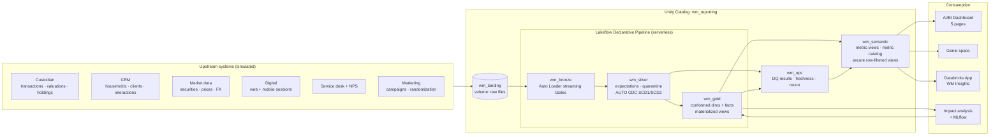
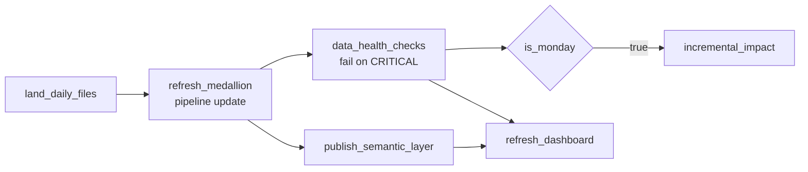

# Architecture

## Overview

## Daily run (06:30 Toronto, business days)

A critical data-health failure (stale data, a break between holdings and valuations, an orphan account, an AUM bridge that doesn't close) **fails the run before the dashboard refreshes**. Business users keep yesterday's correct numbers instead of seeing today's wrong ones.

## Design decisions

| # | Decision | Why | Trade-off |
|---|---|---|---|
| 1 | **Lakeflow Declarative Pipelines** for bronze, silver and gold | Declarative dependencies, built-in expectations with metrics in the event log, AUTO CDC, and incremental materialized-view refresh on serverless | Less imperative control. Complex one-off logic (impact analysis) runs in jobs instead |
| 2 | **Metadata-driven bronze** (`FEEDS` config) | Adding a source is a config line, and every feed gets the same lineage columns and rescued-data handling | One generic reader pattern. Unusual feeds need hints |
| 3 | **AUTO CDC SCD1** for transactions and valuations | Custodians re-send files and restate values. Keying on the business key with the latest file winning makes ingestion idempotent | Needs a reliable sequence column (`file_ts`, then `_ingested_at`) |
| 4 | **SCD2** for advisors, households and clients | AUM follows the advisor's branch *as-was*, so a mid-year transfer doesn't rewrite last quarter's branch results | Point-in-time joins in gold (`valid_from <= d < valid_to`) |
| 5 | **Quarantine tables** next to `expect_all_or_drop` | Rejected records stay inspectable, with the names of the rules they failed. Nothing is silently lost | Extra storage, and quarantine needs an owner |
| 6 | **Daily TWR from valuations and flows** (not from positions) | It matches how custodians and performance teams measure. Flows are assumed at end of day, and returns are net of fees | Intraday flow timing is ignored. Modified Dietz is provided as a cross-check |
| 7 | **AUM roll-forward** as the core monthly dataset | Begin + NNA + market = End is the language WM finance uses, and the bridge closing is itself a control | Market movement is derived, so it absorbs any data error. The recon checks guard against that |
| 8 | **UC metric views** as the semantic layer | One definition consumed by dashboards, Genie, SQL and the app. Ratio measures stay correct for any time window | Semi-additive AUM must be documented and respected (the Genie instructions enforce it) |
| 9 | **Secure dynamic views** for row-level security | Gold tables are pipeline-managed. Filtering at the serving layer keeps the pipeline simple, and users see only `wm_semantic` | Two access paths to maintain (metric views for management, secure views for advisor-level detail) |
| 10 | **Randomized campaigns + household DiD** | Randomization gives causal answers. DiD on each household's own change removes persistent wealth differences and tightens CIs for heavy-tailed flows | Needs marketing to hold out a control group. That is a process change, not only a data change |
| 11 | **Dashboards as code** (`tools/build_dashboard.py`) | The dashboard is reviewable in PRs, and CI fails if the JSON drifts from the generator | Designers who prefer the UI must export and commit |
| 12 | **Local test harness** running the *same* SQL files | Gold logic is checked against simulated ground truth in CI in under a minute, with no workspace needed | The harness emulates CDC and expectations in batch. Streaming semantics are covered by the test target |

## Performance and cost

* **Serverless everywhere:** the pipeline, the jobs, the SQL warehouse and the app. There are no clusters to size.
* Gold materialized views refresh **incrementally** where the planner can. Facts use **liquid clustering** on date and key (`CLUSTER BY`).
* The AUM daily fact aggregates *before* the point-in-time advisor join, which keeps that join at advisor-day grain rather than account-day.
* History backfills land as monthly files and daily increments as daily files. Auto Loader file notification mode can be switched on for high-volume production feeds.

## Security and governance

* Catalog per environment (`wm_reporting_dev`, `_test`, `wm_reporting`). Schemas are owned by the bundle.
* Groups: engineers (all layers), analysts (gold, semantic, ops read), business users (semantic only), leadership (sees all advisor books) and PII readers.
* `advisor_access_map` + `can_see_advisor()` provide row-level security in the secure views. `mask_email()` and initials-only names mask PII.
* Tags: `domain`, `layer` and `data_classification` on schemas, and `pii` on client columns, for discovery and ABAC policies.
* The dashboard does **not** embed credentials, and the app uses **on-behalf-of-user** auth, so row filters follow the viewer everywhere.
