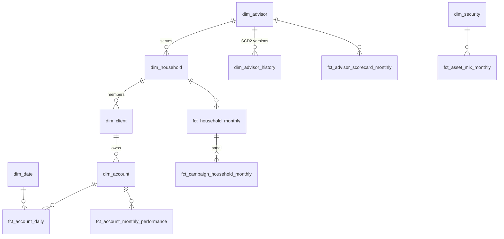

# Data model

## Gold star schema

## Dimensions

| Table | Grain | Notes |
|---|---|---|
| `dim_date` | calendar day, 2020–2028 | Business-day and last-business-day-of-month flags. Fiscal year runs Nov–Oct |
| `dim_advisor` | advisor (current) | Hierarchy: advisor, then branch, then region. Tenure and designation |
| `dim_advisor_history` | advisor × version | SCD2 `valid_from` / `valid_to` for as-was attribution |
| `dim_household` | household (current) | Segment, onboarding date, closed date, tenure band |
| `dim_client` | client (current) | **PII** (name, email). Age band, risk profile. Masked in `wm_semantic.v_client_directory` |
| `dim_account` | account | Registration type (RRSP/TFSA/RESP/RRIF/FHSA/Non-Registered), program, revenue model, fee bps |
| `dim_security` | security | Asset-class hierarchy |

## Facts

| Table | Grain | Key measures |
|---|---|---|
| `fct_account_daily` | account × business day | market value, net external flow, inflow, outflow, fees, commissions, **daily return** |
| `fct_account_monthly_performance` | account × month | begin/end MV, flows, market movement, **TWR**, **Modified Dietz** |
| `fct_aum_daily` | day × advisor × segment × program × account type | AUM, funded accounts and households, with as-was branch and region |
| `fct_aum_rollforward_monthly` | month × advisor × segment × program × account type | **AUM bridge** (begin, inflows, outflows, market, end) and revenue |
| `fct_asset_mix_monthly` | month-end × advisor × segment × asset class | market value from position-level holdings |
| `fct_household_monthly` | household × month | assets, flows, revenue, interactions, meetings, plans, digital, cases, complaints, SLA, NPS counts, new/attrited flags |
| `fct_advisor_scorecard_monthly` | advisor × month | quantity and quality KPIs, within-region percentile ranks, quantity score, quality score |
| `fct_service_quality_monthly` | month × region × category × channel | volumes, average/median/p90 resolution hours, SLA breach rate |
| `fct_digital_engagement_monthly` | month × segment × age band × channel × feature | sessions, active clients, session length |
| `fct_campaign_household_monthly` | campaign × household × month | treatment/control, pre/post panel for DiD |
| `fct_campaign_trend` | campaign × group × relative month | per-household averages for trend charts |
| `campaign_impact_results` | campaign × metric | DiD estimate, 95% CI, lift, verdict (written by the impact job) |

## Silver entities

| Table | Load pattern | Key |
|---|---|---|
| `advisors`, `households`, `clients` | AUTO CDC **SCD2** | advisor_id / household_id / client_id |
| `accounts`, `service_cases` | AUTO CDC SCD1 | account_id / case_id |
| `transactions` | expectations + AUTO CDC SCD1 (dedupe re-sends) | txn_id |
| `valuations` | expectations + AUTO CDC SCD1 (restatements) | account_id, as_of_date |
| `transactions_quarantine`, `valuations_quarantine` | streaming append of rejected rows + `_failed_rules` | — |
| `holdings`, `prices`, `fx_rates`, `crm_interactions`, `digital_sessions`, `nps_responses` | streaming append with expectations | natural keys |
| `branches`, `securities`, `campaigns`, `campaign_assignments` | materialized views | natural keys |

## Data-quality rules

Rules are declared once in `src/wm_common/quality.py` and used by the pipeline (`expect_all_or_drop` / `expect_all`), the quarantine tables and the local tests.

| Entity | DROP (row removed and quarantined) | WARN (kept, pass rate tracked) |
|---|---|---|
| transactions | null txn_id or account, unknown type, missing or future trade date, null amount | settle before trade, trade without security, non-positive quantity |
| valuations | malformed account id, null date, negative MV | cash above MV |
| clients | null client or household | malformed email, implausible birth year |
| prices / NPS / cases | non-positive price, score outside 0–10, missing case keys | closed before opened |
